<!--
  Theme: GitHub surfaces + violet to cyan accent.
    dark  surface #161b22  border #30363d  accent #a78bfa -> #22d3ee
    light surface #f6f8fa  border #d0d7de  accent #7c3aed -> #0891b2
  Banner and project cards live in assets/. Edit scripts/build.mjs, then run: node scripts/build.mjs
-->

<picture>
  <source media="(prefers-color-scheme: dark)" srcset="assets/banner-dark.svg" />
  
</picture>

 

  Computer science student shipping across the stack:
  Windows apps, .NET tools, IoT dashboards and research prototypes.

  <picture>
    <source media="(prefers-color-scheme: dark)" srcset="https://skillicons.dev/icons?i=ts,js,react,nodejs,express,prisma,electron,vite,cs,dotnet,py,flutter,dart,java,firebase,git&perline=8&theme=dark" />
    
  </picture>

 

  <a href="https://github.com/J-isaac007/raster"><picture><source media="(prefers-color-scheme: dark)" srcset="assets/raster-dark.svg" /></picture></a>
  <a href="https://github.com/J-isaac007/BahAlert"><picture><source media="(prefers-color-scheme: dark)" srcset="assets/bahalert-dark.svg" /></picture></a>
  <a href="https://github.com/zero0no1one/NASA_GITCANTCOMMIT"><picture><source media="(prefers-color-scheme: dark)" srcset="assets/echo-path-dark.svg" /></picture></a>
  <a href="https://github.com/J-isaac007/FlipFace"><picture><source media="(prefers-color-scheme: dark)" srcset="assets/flipface-dark.svg" /></picture></a>

  Try <a href="https://j-isaac007.github.io/BahAlert/"><b>BahAlert live</b></a> · Download <a href="https://github.com/J-isaac007/raster/releases/latest"><b>Raster for Windows</b></a>

  
<b>More projects</b>

   

| Project | What it is | Stack |
| --- | --- | --- |
| [To-Do List API](https://github.com/J-isaac007/to-do-list-api) | REST API with auth and per-user todo CRUD | Express 5, Prisma, TypeScript |
| [Aura](https://github.com/FerosC101/Aura) | Startup app, early stage (team) | Flutter |
| [OOP 101 Activities](https://github.com/J-isaac007/CS2101_EscalJI_OOP101_Activities) | University coursework | Java |

 

  <picture>
    <source media="(prefers-color-scheme: dark)" srcset="https://streak-stats.demolab.com/?user=J-isaac007&background=161b22&border=30363d&stroke=30363d&ring=a78bfa&fire=22d3ee&currStreakNum=e6edf3&sideNums=e6edf3&currStreakLabel=a78bfa&sideLabels=8d96a0&dates=8d96a0&border_radius=16" />
    
  </picture>

